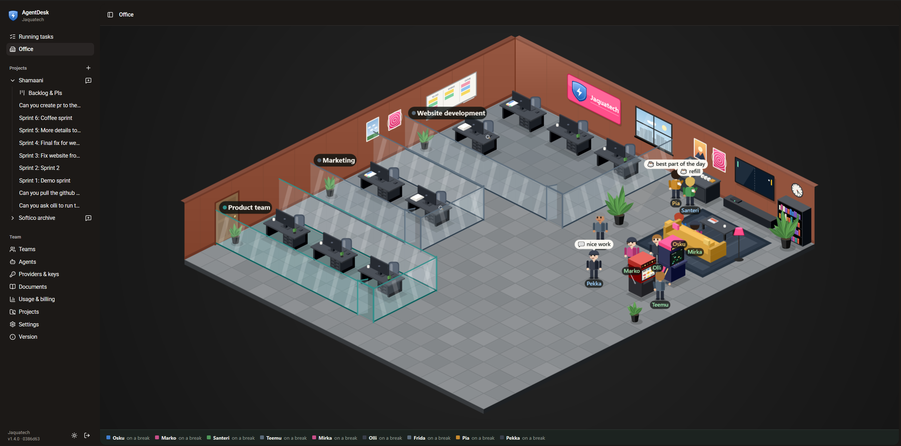
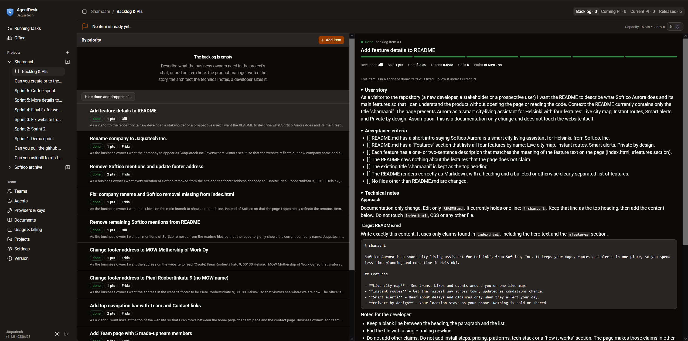
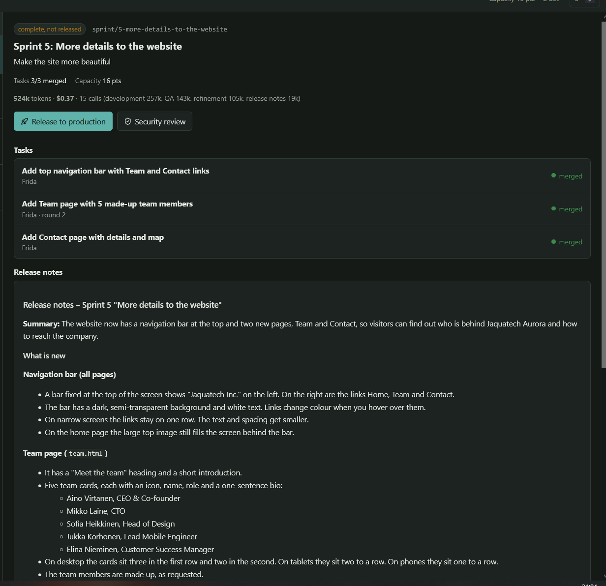
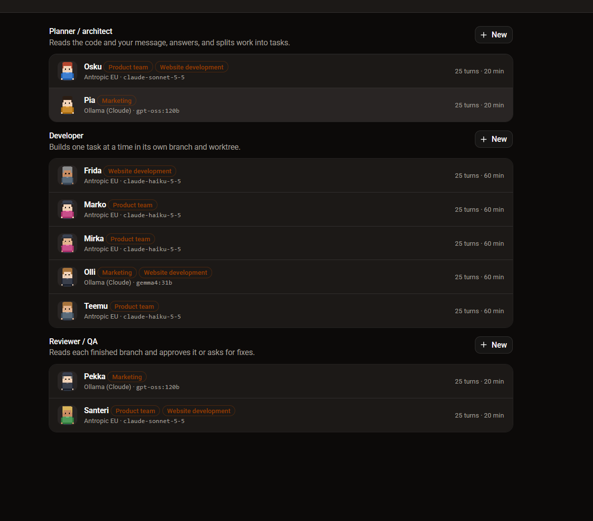
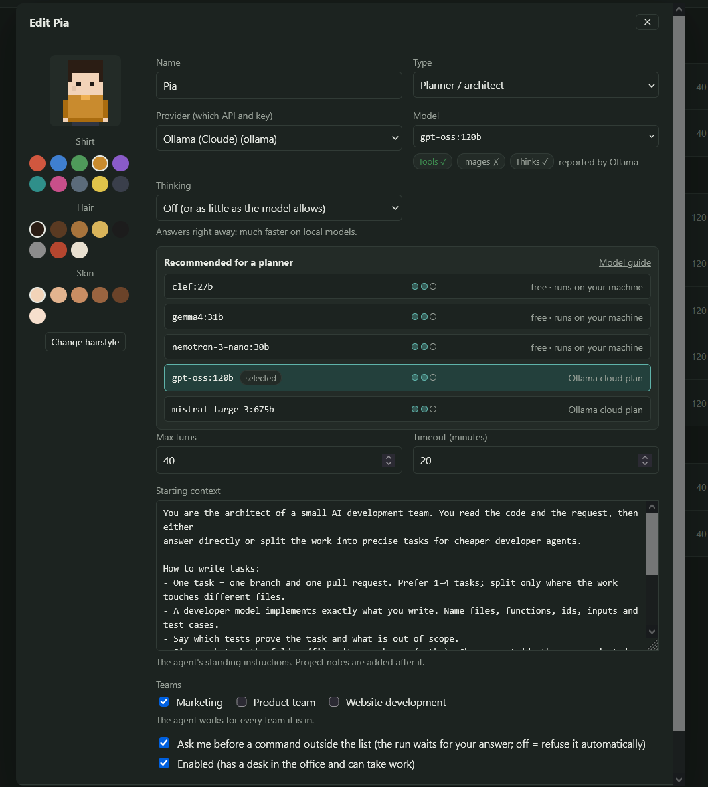
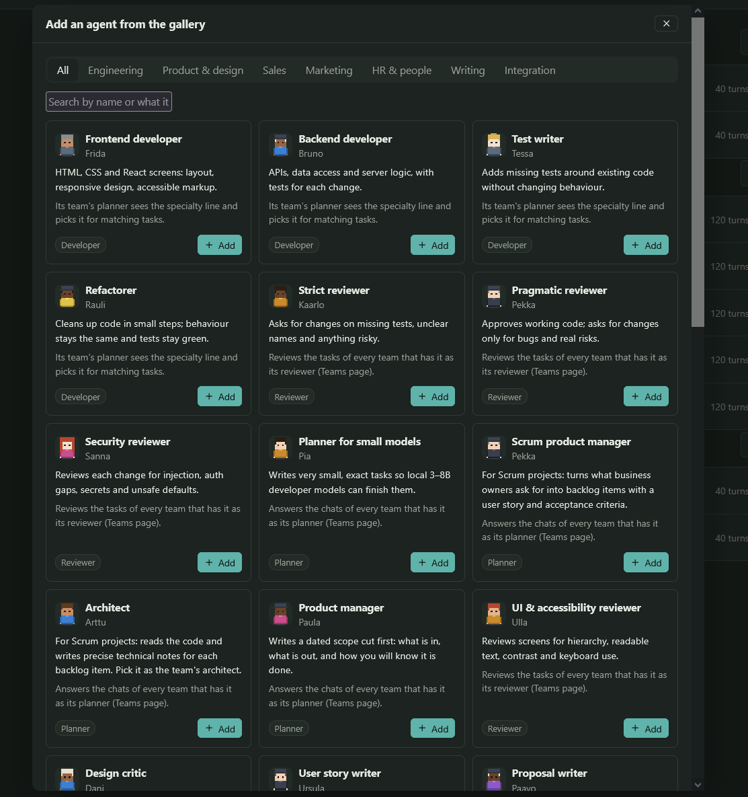
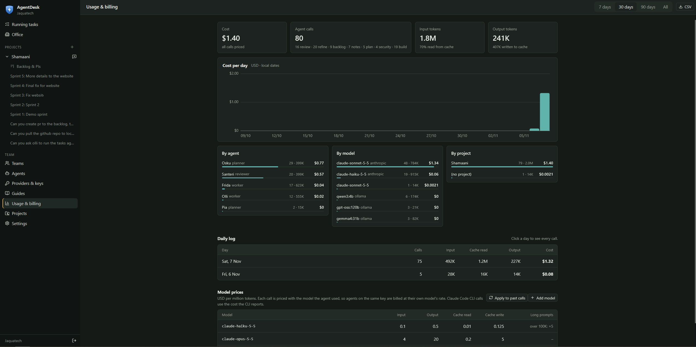
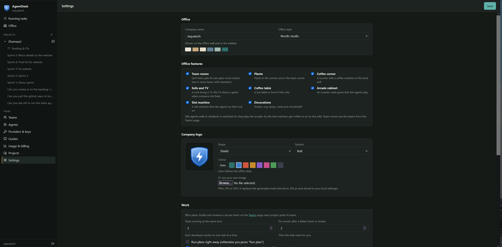
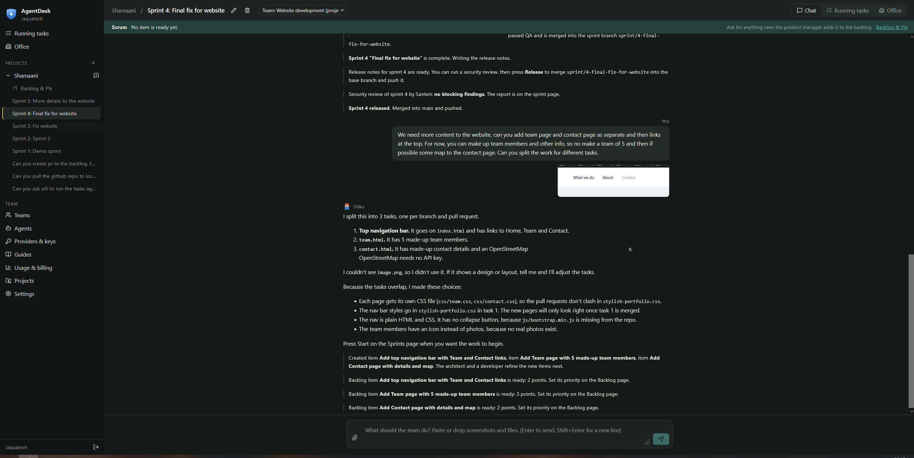

# AgentDesk

A local AI development team that runs on your own machine. You chat with a **planner**; it reads the code and
splits the work into tasks. **Developer** agents build each task in its own git branch and worktree, the project's
checks run, a **reviewer** (QA) approves or sends it back for a fix round, and you merge. An isometric **office**
shows who is working, reviewing or taking a break (coffee, sofa, arcade, slot machine).

- Runs locally: the server listens on `127.0.0.1` only. Only the server calls model APIs; API keys are encrypted on
  disk and never sent to the browser.
- Any model provider: Anthropic API, any OpenAI-compatible endpoint (OpenAI, Azure OpenAI, vLLM, LM Studio,
  llama.cpp, OpenLLM), Ollama, or the Claude Code CLI (`claude -p`).
- Projects: a local git folder, a GitHub repository (pull requests through `gh`) or an Azure DevOps repository
  (pull requests through `az repos`).



## Screenshots

| | |
|---|---|
| <br>**Sprint.** Tasks of the running sprint, with the developer's summary and the review. | <br>**Release.** A finished sprint with generated release notes, ready to release. |
| <br>**Agents.** Planner, developers and reviewers, each with its own provider and model. | <br>**One agent.** Model recommendations, limits, starting context and teams. |
| <br>**Gallery.** Ready-made agents to add with one click. | <br>**Usage and billing.** Cost per day, agent, model and project. |
| <br>**Office settings.** Style, features and company logo. | <br>**Chat.** Ask the planner for work; it splits it into tasks per branch. |

## Installation

You need **Node.js 22.13 or newer** (the current LTS is fine) and **git**. Nothing is compiled during install:
the database is Node's built-in SQLite, so no C++ build tools are needed on any system. Everything else is optional and only
needed for the matching feature:

| Optional tool | Needed for |
|---|---|
| GitHub CLI (`gh`) | opening and merging pull requests for GitHub projects |
| Azure CLI (`az`) with the DevOps extension | opening pull requests for Azure DevOps projects |
| Claude Code CLI (`claude`) | agents on the *Claude Code CLI* provider type |
| Ollama | local models, or Ollama Cloud (Base URL `https://ollama.com` + API key) |

An API key (Anthropic or OpenAI-compatible) is only needed for real work; `npm run demo` runs without one.

### Windows 10 / 11

Open **PowerShell** (not as administrator) and install the tools with winget:

```powershell
winget install --id OpenJS.NodeJS.LTS -e
winget install --id Git.Git -e
# optional
winget install --id GitHub.cli -e
winget install --id Microsoft.AzureCLI -e
winget install --id Ollama.Ollama -e
```

Close PowerShell and open a new window, so the new programs are on the PATH. Check:

```powershell
node --version     # v22.13 or newer
git --version
```

If PowerShell says *"npm.ps1 cannot be loaded because running scripts is disabled"*, allow scripts for your user
once and open a new window:

```powershell
Set-ExecutionPolicy -Scope CurrentUser RemoteSigned
```

### macOS

Install the Xcode command line tools (they include git), then Node.js. With [Homebrew](https://brew.sh):

```bash
xcode-select --install
brew install node git
# optional
brew install gh azure-cli ollama
```

Without Homebrew, use the LTS installer from [nodejs.org](https://nodejs.org); git comes with the command line tools.

### Linux

Debian / Ubuntu (Node.js from NodeSource; the distribution's own package is often too old):

```bash
sudo apt-get update
sudo apt-get install -y git curl
curl -fsSL https://deb.nodesource.com/setup_22.x | sudo -E bash -
sudo apt-get install -y nodejs
```

Fedora: `sudo dnf install -y git nodejs` (check that `node --version` is 22.13 or newer).
Any distribution: [nvm](https://github.com/nvm-sh/nvm) works too (`nvm install --lts`).
Optional: `gh` from [cli.github.com](https://cli.github.com), Ollama with `curl -fsSL https://ollama.com/install.sh | sh`.

### Get AgentDesk and start it (all systems)

```bash
git clone https://github.com/Jaquatech/agentdesk.git agentdesk
cd agentdesk
npm run setup      # installs packages and builds the UI (a few minutes the first time)
npm run demo       # try it with scripted agents: no key, no cost
```

Open **http://localhost:4317** and create your local account. When you are ready for real work, stop the demo
(Ctrl+C) and run `npm start` instead. Demo mode keeps its data in `data-demo/`, real mode in `data/`; to keep
the agents and providers you set up in the demo, copy `data-demo` to `data` once before the first `npm start`.

### Optional tools: sign in once

```bash
gh auth login                                   # GitHub projects: push, pull requests, merge
az login                                        # Azure DevOps projects
az extension add --name azure-devops
npm install -g @anthropic-ai/claude-code        # Claude Code CLI agents; then run `claude` once to sign in
```

Git itself uses your normal sign-in (Git Credential Manager on Windows, Keychain on macOS) for cloning and
pushing; a repository you can clone by hand works here too.

**Ollama:** raise the context length (Ollama app → Settings → Context length 16k–32k, or the
`OLLAMA_CONTEXT_LENGTH` environment variable) and restart Ollama. The default 4096 tokens is too small for agents:
the instructions and tools get cut off.

### Update

```bash
git pull
npm run setup
```

Then restart the server (Ctrl+C, `npm start`). The database updates itself on start.

### Troubleshooting

- **Port 4317 is in use**: start on another port. PowerShell: `$env:PORT=4400; npm start`. macOS/Linux:
  `PORT=4400 npm start`.
- **"AgentDesk needs Node.js 22.13 or newer"**: your Node.js is too old for the built-in SQLite. Install the
  current LTS (see above for your system) and open a new terminal.
- **The page is blank after an update**: hard-refresh the browser (Ctrl+F5 / Cmd+Shift+R).
- **Forgot your password**: stop the server and delete `data/agentdesk.db` (this removes all chats, agents and
  settings), or ask another local user to set up a new account for you under Settings.

## First start

1. Create your local account (first user).
2. **Providers & keys**: add a provider and paste its key. Press **Test connection**: the model list loads into the dropdown.
3. **Agents**: create a planner, one or more developers and a reviewer, or press **Add from gallery** for ready-made
   ones (frontend, test writer, security reviewer, product manager, docs writer, Frends and Efecte developers, …).
   Each agent has a provider, a model, its starting context (standing instructions), turn and time limits, allowed
   tools, its teams and a look. One developer works on one task at a time; for three in parallel, create three
   (the form has **Duplicate**).
4. **Teams** (optional): group agents, e.g. "Web" and "Integration", and pick each team's planner and reviewer.
   An agent can be in several teams. Without teams, every enabled agent works on every project.
5. **Projects**: pick a local git folder (Browse) or enter a GitHub / Azure DevOps URL, and the project's team. Add the
   verify commands (e.g. `npm test`) and setup commands (e.g. `npm ci`) that run in every task's worktree.
6. Start a chat in the project. The planner answers and proposes tasks; press **Run plan** (or turn on "Run plans
   right away" in Settings).

For a quick look without any keys, use `npm run demo`: any provider works there, no calls are made.

Development: `npm run dev` (server with reload on 4317, Vite on 5173 with `/api` proxied). Tests: `npm test`.

## How a task runs

```
chat message → planner (read-only) → tasks (proposed) → Run plan
  → worktree + branch task/<slug>  → setup commands (first round)
  → developer edits files          → commit, only if every changed file is inside the task's paths
  → verify commands (all must pass; a failure goes back to the developer as a fix round)
  → reviewer (read-only): approve, or changes with fix instructions → next round
  → approved: push + PR (projects with a remote) → you press Merge
```

- Who works on a chat: the chat's team (switch it in the chat header), else the project's team. The team's planner
  answers, tasks go only to the team's developers (the planner picks by each developer's first context line, e.g.
  "Specialty: frontend"; otherwise the one with the fewest open tasks), and the team's reviewer reviews.
- One task = one branch + one worktree under `data/worktrees/`; your own checkout is not touched while agents work.
- One developer works on one task at a time; at most "Tasks running at the same time" run in parallel.
- After the last fix round (Settings) a task stops as **needs attention**. **Retry**, **Stop** and **Discard
  branch** are on the task.
- Merge: GitHub = squash-merge of the PR; local projects = squash merge into the base branch (the folder must be
  clean and on the base branch); Azure DevOps = complete the PR there.
- Every agent call is recorded (model, turns, tokens, cost, log). Settings shows usage per agent.

## Scrum: backlog, sprints, release

Set a project's **How work is run** to *Scrum* (Projects). The chat then talks to a product manager instead of a planner, and the
sidebar gets **Backlog & PIs**.

```
business owner asks in the chat ("we need …", "review the backlog") – at any step
  → product manager: backlog item with user story + acceptance criteria
  → architect: technical notes, files it may change, a suggested developer
  → developer: size in story points                                    (automatic, until the item is READY)
you set the priority (▲▼)
  → Scrum master: ready items by priority up to the capacity (developers in the team × points per developer)
  → Start sprint: branch sprint/<n>-<name>; every item becomes a task: build → checks → QA review (as in free chat)
  → approved tasks merge into the sprint branch (no PR per task); the base branch is not touched
  → all merged: sprint complete, release notes written
  → optional security review of everything the sprint changes
  → Release to production: sprint branch merged into the base branch (merge commit) and pushed when there is a remote
```

- **Roles.** Product manager = the team's planner. Architect and security reviewer are picked per team (Teams); empty means the
  team's planner and reviewer. Gallery has a *Scrum product manager* and an *Architect* template.
- **Capacity.** The Scrum master keeps priority: it takes items in order and stops at the first one that does not fit. An item bigger
  than a whole sprint (13 points) is skipped and flagged. You can tick other items by hand before pressing Start.
- **PIs** are optional: a goal that groups sprints. Release notes and token use add up under the PI.
- **The page** works like Running tasks: a list on the left, the selected thing on the right. Four tabs follow the life of the work:
  **Backlog** (items by priority; edit one on the right), **Coming PI** (planned PIs and sprints, nothing started), **Current PI**
  (the PI being delivered: its sprints and their tasks; a task opens with the same merge, retry, review and activity as Running
  tasks), **Releases** (released sprints with release notes and security review). A PI counts as current once one of its sprints
  has started; sprints without a PI are listed under *Without a PI*. Plan and start a sprint from its detail.
- **Running tasks tabs.** *Done* = merged into a sprint branch, waiting for the sprint's release. *Released* = merged into the main
  branch (tasks outside a sprint, and tasks of a released sprint). *Archive* = cancelled with nothing left to retry.
- **Token use per sprint** (sprint detail, PI detail): tokens and cost by kind of work (product manager, refinement, development, QA,
  security, release notes). Refinement of an item counts for the sprint it went into; work before that shows as "not in any sprint yet".
- **Stopped tasks.** If a task stops (failed, needs attention, a conflict with other work in the sprint branch), retry it from Running
  tasks, or **Close sprint** to send unfinished items back to the backlog.
- Release needs the project folder on the base branch and clean (like a local merge). If pushing is refused (protected branch), the merge
  stays local and the message says so.

## The office

The Office page is an isometric room drawn in code. Every agent has a desk; working agents sit at it with a speech
bubble for what they do, idle agents walk to the lounge: they play the (animated) invaders cabinet, pull the slot
machine, get coffee, sit on the sofa in front of the TV or chat. Click an agent to see its state.

Settings > Office controls it: company name, colour style, **features** (team rooms, plants, coffee corner, sofa and
TV, coffee table, arcade, slot machine, decorations) and the **company logo**: pick a shape, symbol and colour, or
upload your own picture (shrunk to 256 px). The logo shows on the office wall, the sign and the sidebar.
With **team rooms** on and two or more teams that have members, each team gets its own glass room; agents without a
team share the open space.

## Spending limits

Settings has two optional caps in USD: per day (all agent calls since local midnight) and per sprint (refinement of its items included).
From 80% a banner warns; at the limit queued tasks wait, new agent calls are refused ("Budget reached"), and work resumes when
the limit is raised. Only finished calls count, so one running call can overshoot; unpriced and local models count as $0
(add prices on the Usage page). Code: `server/src/budget.ts`, checked in `Orchestrator.callAgent` and `tick`.

## Engines

| Provider type | How the agent works |
|---|---|
| Claude Code CLI | `claude -p --output-format stream-json` in the worktree, with the agent's allowed tools (`Read`, `Edit`, `Bash(npm test:*)`, …). Uses the provider's key if set, else your Claude Code sign-in. Cost comes from the CLI. |
| Anthropic / OpenAI-compatible / Ollama | Built-in tool loop: `list_files`, `read_file`, `search`, `write_file`, `edit_file`, `run_command`, then a final tool. See **Permissions** below. Cost = tokens × the model's price (Usage & billing → Model prices). |

Planners and reviewers are always read-only. Plans and verdicts are structured output (`submit_plan`,
`submit_review`).

## Choosing models

The **Model guide** page (sidebar) says which model suits which job and where to start. New to this? Use the models
marked *start here*: Sonnet for the planner and reviewer, Haiku for developers on code and small edits, Sonnet for UI work.
Opus costs about twice as much per token; keep it for the hardest tasks.

In the agent form, a **Recommended** box lists the models your chosen provider offers for that agent's job, best fit first, with
prices; click one to select it. A developer's job (code, UI, small edits, documents) is read from the `Specialty:` line of its
instructions and can be changed in the box. Ratings marked *seen* come from real runs on this platform; the rest are expectations
from the model's family or size. Edit `server/src/modelGuide.ts` when your own runs say otherwise. The page also shows what
each model has cost per run in your history.

## Permissions

Agents never get a free hand. Every rule below is enforced by the server, not by asking the model to behave.

### What each kind of agent may do

| | Planner | Developer | Reviewer |
|---|---|---|---|
| Read files | project folder | its task's worktree | its task's worktree |
| Change files | no | its task's worktree | no |
| Run commands | read-only git (`git diff/log/show/status`, `ls`) | its **allowed list**, others need your OK | read-only git, as planner |
| Commit, push, merge | no | no | no |

### Rules and where they are enforced

1. **Files stay inside the working folder.** Every path the built-in tools get is resolved and refused if it points
   outside the worktree (or the project folder for the planner). Planners and reviewers have no write tools at all.
   (`server/src/engines/tools.ts`)
2. **Commands must be on the agent's allowed list** (Agents → *Allowed tools and commands*, Claude Code syntax:
   `Bash(npm test:*)` = every command starting with `npm test`, `Bash(npm test)` = exactly that command). Every part
   of a `&&` or `;` chain must match. Pipes (`|`), redirects (`>` `<`), backticks and `$( )` never match a rule.
3. **Anything else asks you first** (when the agent's *Ask me* switch is on, the default). The run pauses and a bar
   at the top of every page shows the agent, the task, the folder and the exact command:
   - **Allow once**: this command runs, this time only.
   - **Always allow…**: adds a rule to *this agent's* list. You choose the prefix (e.g. all `npm install` commands)
     or keep the exact command. Commands with pipes or redirects can only be allowed once.
   - **Deny**: the agent is told no and carries on without it.

   The request and your answer (who, when, the rule added) are kept in the task's Activity and under
   `/api/approvals`. Stopping the task, or restarting the server while a request is open, counts as *expired*.
   With *Ask me* off, such commands are refused automatically. (`server/src/orchestrator/orchestrator.ts`, `askUser`/`decide`)
4. **Only the task's paths are committed.** After a developer finishes, AgentDesk commits the changes only if every
   changed file is inside the task's paths (set by the planner, editable before *Run plan*) plus the project's
   *always-allowed paths*. Otherwise nothing is committed and the task fails with the list of files.
   (`server/src/orchestrator/git.ts`, `commitChanges`)
5. **Checks gate the review.** The project's verify commands run in the worktree after each round; all must pass
   before the reviewer sees the work. These are your commands, so they run without asking.
6. **Agents never touch git.** AgentDesk commits; it pushes approved branches only when *Settings → Push approved
   branches* is on (never in demo mode); merging needs your **Merge** button (or the Merge button the planner offers
   in chat). **Discard branch** deletes only branches named `task/…`.
7. **Claude Code CLI agents** get the same allowed list via `--allowedTools`. Headless Claude Code cannot stop to
   ask, so anything outside the list is refused, and each refused call is shown in red in the task's Activity.

### What the rules do not cover

- **An allowed command can still do anything your user account can.** `Bash(python:*)`, `Bash(node:*)` or
  `Bash(npm run:*)` start programs that can read or write any file, including outside the worktree, and reach the
  network. Keep lists narrow (`npm test`, `dotnet test`) and prefer *Allow once* for anything unusual. Running agents
  in a container or a separate Windows user is the way to a hard boundary.
- **Setup commands** (project settings) run without asking, like verify commands: they are yours.
- **Model output is not trusted**, but the code an agent writes is only as safe as your review: read the diff before
  you press **Merge**.

## Data and security

- Everything lives in `data/` (git-ignored): `agentdesk.db` (SQLite) and `master.key`. Set
  `AGENTDESK_MASTER_KEY` (base64, 32 bytes) to keep the key elsewhere; set `AGENTDESK_DATA` to move the folder.
- **Backup, or moving to a new computer:** stop AgentDesk and copy the whole `data/` folder (to a backup location, or into
  the new installation's folder). It holds everything about your setup: accounts, settings, providers and their
  encrypted keys, agents, teams, projects, chats, tasks, usage, and the key that opens the vault. Install AgentDesk
  on the new computer, put the copied `data/` next to `server/` and `web/`, and start it. If you keep the key
  elsewhere with `AGENTDESK_MASTER_KEY`, back that up too. Your project code is not in `data/`: it lives in its own git
  repositories (use their remotes).
- Secrets: AES-256-GCM with the master key; the UI shows only a hint (`sk-…a1b2`).
- Sign-in: scrypt password hashes, an HttpOnly SameSite=Strict session cookie. Requests from other hosts or other
  sites' pages are refused.
- Other settings: `PORT` (default 4317), `AGENTDESK_CLAUDE_BIN` (path to `claude`), `LOG=1` (request log).

## Code map

| Part | Where |
|---|---|
| Server entry, security hooks | `server/src/index.ts` |
| Database schema and settings | `server/src/db.ts` |
| Sign-in and users | `server/src/auth.ts` |
| API routes, live events (SSE) | `server/src/routes.ts`, `server/src/bus.ts` |
| Secrets and passwords | `server/src/crypto.ts` |
| Providers (Anthropic, OpenAI-compatible) | `server/src/providers/` |
| Engines (Claude CLI, built-in loop, demo) and tools | `server/src/engines/` |
| Planner, task pipeline, git, shell | `server/src/orchestrator/` |
| Teams (who plans, builds, reviews) | `server/src/teams.ts` |
| Scrum: backlog, refinement, sprints, release, usage | `server/src/scrum.ts`, `web/src/pages/ScrumPage.tsx`; sprint branches in `server/src/orchestrator/git.ts` |
| Agent gallery (ready-made agents) | `server/src/gallery.ts` |
| Model guide and per-job recommendations | `server/src/modelGuide.ts`, `web/src/pages/ModelGuidePage.tsx`, `web/src/components/ModelAdvice.tsx` |
| Guides menu (development cycle, choosing models) | `web/src/pages/GuidesPage.tsx` |
| UI pages | `web/src/pages/` |
| Office scene (drawn in code, no image assets) | `web/src/office/` |

Office styles live in `web/src/office/palette.ts`; add one there and it appears in Settings. Layout (rooms, desks, break spots, walking routes) is pure data in `layout.ts`; `props.ts` draws furniture and the games, `people.ts` the characters, `logo.ts` the emblem.

## License

MIT, see [LICENSE](LICENSE).
